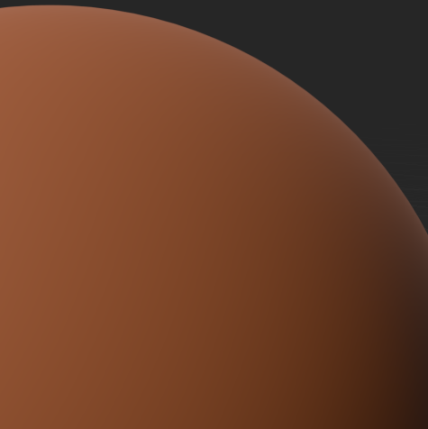

# Wood Finish

<table>
  <tr style="border: 0;">
    <td style="border: 0;" valign="top"> <strong>In:</strong> Wear and Finish</td>
    <td style="border: 0;" valign="top">Description Add normal and roughness details to your material to add finishes generally associated with wood such as varnish, ceruse, or wood grain. <em>A plain fill color</em><strong><em> </em></strong><em>is given the appearance of wood by adding wood grain with the </em><strong><em>Wood Finish filter</em></strong><em>.</em> </td>
  </tr>
</table>

## Parameters

**Basic parameters**

* **Random Seed**:

  The random seed determines the random values of other parameters that use randomness in this filter.

* **Finish Type**:

  Select a style to apply to your metal. Each style has different parameters that allow you to adjust it's appearance. Other than the **Natural** finish, each finish has a set of parameters available to control the effect.

  The following finishes are available:

  * **Natural**: A smooth natural finish for processed wood.
  * **Ceruse**: Create a soft, two-tone look, by filling open pores with a pigment.
  * **Matte Varnish**: Add a soft matte varnish finish.
  * **Varnish**: Add a highly reflective varnish finish.
  * **Old**: Adjust the color and roughness of the underlying material to create the appearance of aged wood.
  * **Raw**: Add wood grain to create the appearance of raw cut lumber.
  * **Sawn**: Add saw tracks to create the appearance of wood fresh from the lumbermill.

### Shared parameters

The following parameters appear for multiple finishes:

* **Hue**: Adjust the color of the material.
* **Saturation**: Adjust color strength.
* **Luminosity**: Adjust brightness.
* **Roughness Intensity**: Adjust the Roughness of the material.
* **Fibers Roughness Intensity**: Adds high-frequency roughness information to the Roughness map. Combines with the Roughness Intensity slider to modify Roughness values, whether the material is very smooth or very rough.
* **Normal Intensity**: Adjust the strength of the normal map.
* **Fibers Mask Contrast**:

### Finishes

#### Ceruse

* **Color 1**:
* **Color 2**:
* **Base Color Variations**:
* **High Frequency Details**:

#### Varnish

* **Normal Fibers Orientation Variations**:

#### Old

* **Varnish Roughness Intensity**:
* **Effect Rotation**:

#### Raw

* **Normal Additional Information**:

#### Sawn

* **Roughness Reduction with Fibers**: Adjust roughness along the saw lines, creating roughness contrast.
* **Saw Cuts Number**: Adjust the number of saw lines.
* **Mask Regularity**: Adjust how regularly the saw lines appear. A higher value makes lines less regular.
* **Additional Fibers**: Adjust the number of fibers that are added parallel to the saw lines.
